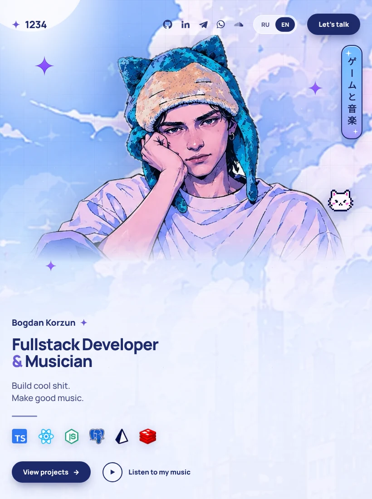
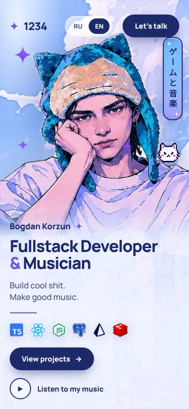

# Сайт-визитка Богдана Корзуна

Личное портфолио: Fullstack-разработчик и музыкант. Одностраничный сайт на **Vue 3 + TypeScript + Vite**, чистый CSS, без UI-библиотек.


| Планшет                                       | Телефон                                       |
| --------------------------------------------- | --------------------------------------------- |
|  |  |

Полная страница: [docs/screenshots/full-page-desktop.webp](docs/screenshots/full-page-desktop.webp)

**Живая ссылка:** после первого деплоя здесь будет адрес вида `https://<твой-логин>.github.io/<имя-репозитория>/` (см. «Публикация»).

## Что внутри

- Hero с параллаксом (курсор + прокрутка), слои: небо, облака, город, сетка, персонаж, декор.
- Секции: Projects, Music, About, Contact и подвал.
- Переключатель RU / EN, выбор запоминается в браузере.
- Для `prefers-reduced-motion` анимации и параллакс отключаются.
- Картинки в WebP, у каждой заданы размеры (нет скачков вёрстки).

## Запуск

Нужен Node.js 22 или новее.

```bash
npm install     # поставить зависимости
npm run dev     # запустить сайт локально (адрес покажет в терминале)
```

Остальные команды:

| Команда            | Что делает                                              |
| ------------------ | ------------------------------------------------------- |
| `npm run build`    | проверяет типы и собирает сайт в папку `dist`           |
| `npm run preview`  | показывает собранный сайт локально                      |
| `npm run lint`     | ESLint: ищет ошибки в коде                              |
| `npm run format`   | Prettier: приводит код к единому стилю                  |
| `npm test`         | юнит-тесты (Vitest)                                     |
| `npm run test:e2e` | тесты в браузере: Playwright + проверка доступности axe |

Для e2e один раз поставь браузер: `npx playwright install chromium`.

## Как поменять тексты, проекты и ссылки

Всё, что видно на сайте, лежит в одном файле: [`src/data/site.ts`](src/data/site.ts).

- **Контакты и соцсети** — блок `contacts` (почта, GitHub, LinkedIn, Telegram, WhatsApp, SoundCloud).
- **Проекты** — массив `projects`. Чтобы добавить новый, скопируй закомментированный блок, заполни поля и положи обложку в `src/assets/img/` (формат WebP, 870×231).
- **Тексты** — объект `t`, отдельно `ru` и `en`. Ключи в обоих языках должны совпадать (это проверяет тест).

## Структура

```text
src/
  assets/        картинки и шрифты
  components/    части страницы (Hero, Projects, Music, About, Contact...)
  composables/   параллакс, язык, появление секций
  data/          тексты, проекты, ссылки
  styles/        глобальный CSS
tests/
  unit/          Vitest
  e2e/           Playwright + axe
.github/workflows/
  ci.yml         проверки на ветках и pull request
  deploy.yml     проверки + публикация на GitHub Pages
```

## Публикация на GitHub Pages

1. Создай репозиторий на GitHub и отправь туда код (ветка `main`).
2. В репозитории открой **Settings → Pages** и в поле **Source** выбери **GitHub Actions**.
3. Любой пуш в `main` запускает `deploy.yml`: прогоняет проверки, собирает сайт и публикует его.

Адрес в Vite (`base`) подставляется сам: в workflow он равен `/<имя-репозитория>/`. Локально `base` равен `/`. Если сайт будет на своём домене или в репозитории `<логин>.github.io`, поменяй `VITE_BASE` в `deploy.yml` на `/`.

## Заметки

- Картинка для превью в соцсетях лежит в `public/og.jpg`. Для ссылок в мессенджерах нужен полный адрес в теге `og:image`, поэтому после публикации замени его на `https://<адрес-сайта>/og.jpg` в `index.html`.
- Иллюстрации (персонаж, город, кот) сделаны автором. Разрешение у персонажа небольшое, на очень больших мониторах мелкие детали выглядят мягче. Файл `src/assets/img/character.webp` можно заменить на версию лучше качеством без правок вёрстки.
