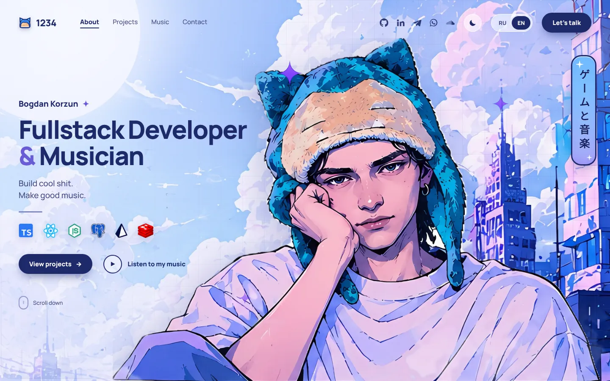
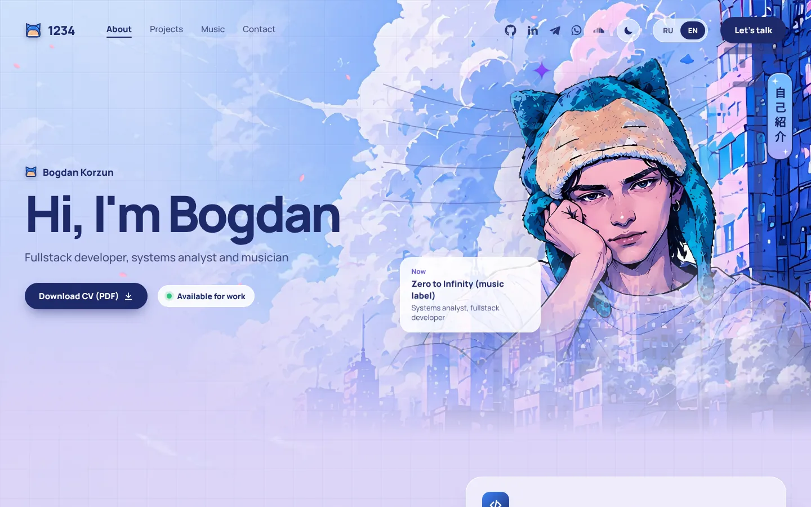
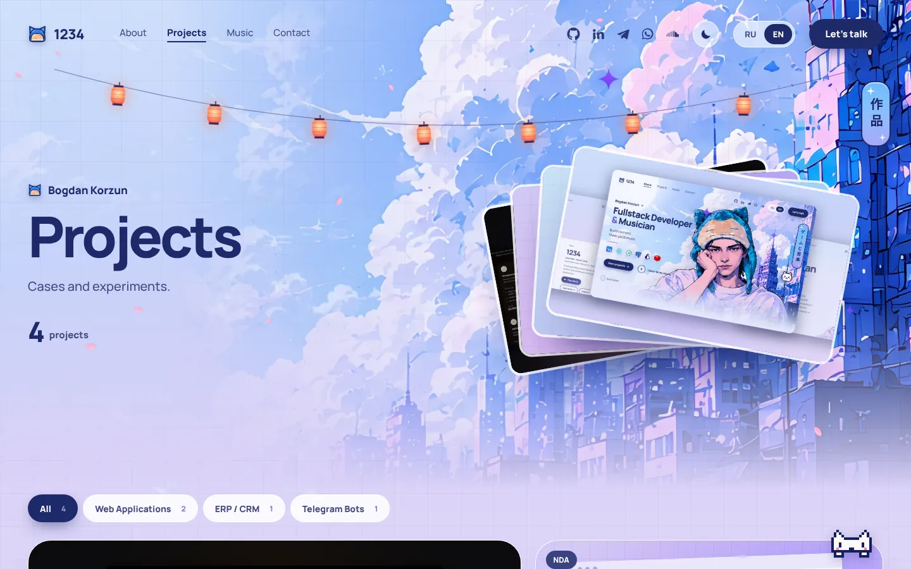
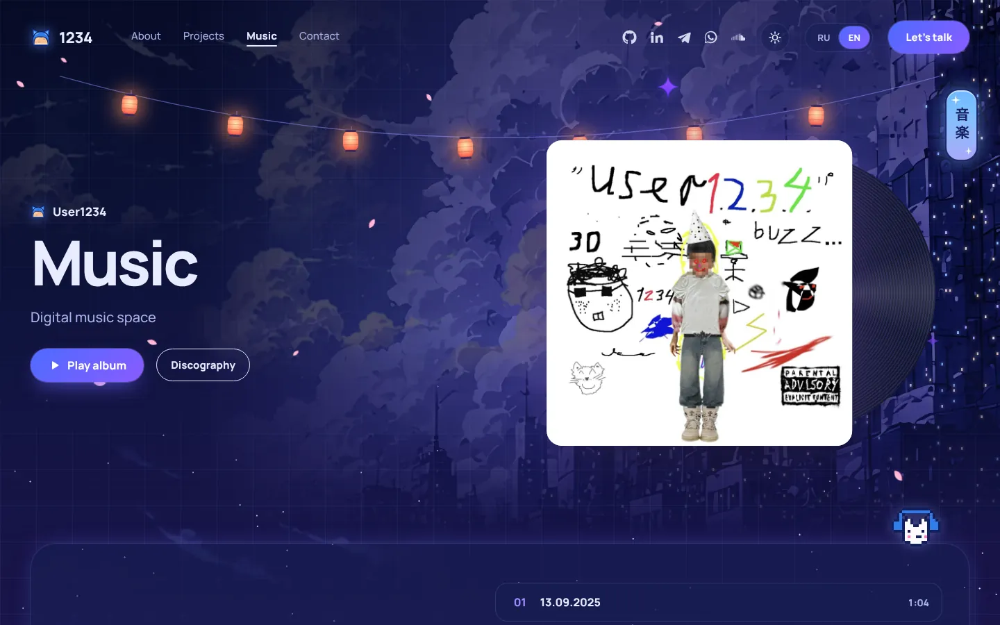
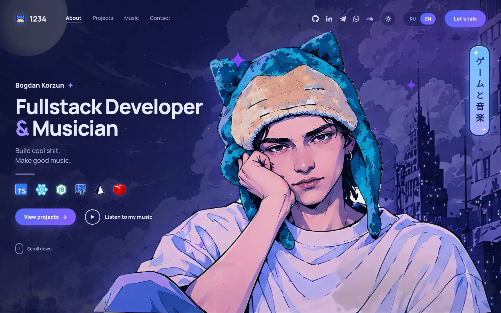
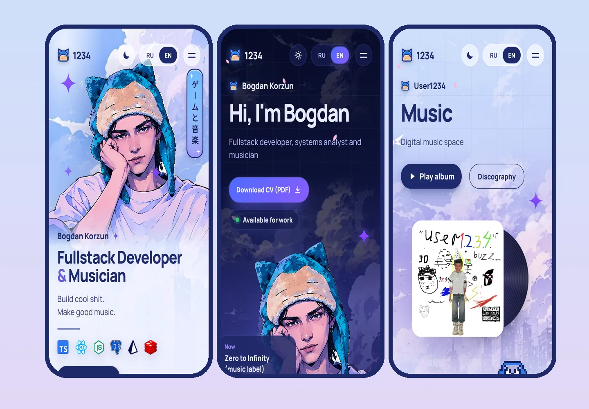

<div align="center">


# 1234 — портфолио Богдана Корзуна

Fullstack-разработчик, системный аналитик и музыкант.
Личный сайт в духе японского аниме-города: облака, ночной Токио, пиксельный котик.

**[user1234-code-maker.github.io/1234-site](https://user1234-code-maker.github.io/1234-site/)**

[](https://github.com/User1234-Code-maker/1234-site/actions/workflows/deploy.yml)




</div>

## О проекте

Многостраничный сайт-визитка на **Vue 3 + TypeScript + Vite** без UI-библиотек: вёрстка, анимации, плеер и иллюстративные сцены написаны вручную. Две темы, два языка, своя заставка и котик-талисман, которого можно таскать по экрану.

<table>
  <tr>
    <td></td>
    <td></td>
  </tr>
  <tr>
    <td></td>
    <td></td>
  </tr>
</table>

<p align="center"></p>

## Возможности

| Страница           | Что там                                                                                                                  |
| ------------------ | ------------------------------------------------------------------------------------------------------------------------ |
| `/`                | Hero с персонажем и параллаксом, короткие блоки: работы, музыка, обо мне, контакты                                       |
| `/about`           | Персонаж в облаках, путь по годам, навыки, опыт, альбом можно включить прямо на странице, резюме PDF                     |
| `/projects`        | Галерея с «неровной» сеткой и плавной фильтрацией по категориям                                                          |
| `/projects/<slug>` | У каждого проекта своя подача: превью в рамке, факты, подробности, что сделано, стек по группам, схема, следующий проект |
| `/music`           | Обложка с пластинкой, собственный плеер с волной и перемоткой, дискография, площадки                                     |
| `/contact`         | Вечерний город с тории, почта с копированием, карточки соцсетей                                                          |
| `/*`               | Страница 404 с улетевшим островком                                                                                       |

- **Светлая и тёмная тема.** Тёмная — ночной город со светящимися окнами, а не инверсия. Переключение плавное (View Transitions), без вспышки при загрузке.
- **RU / EN.** Все тексты в словаре, переключение мгновенное.
- **Свой аудиоплеер.** Один общий `<audio>`, мини-плеер не прерывается при переходах, Media Session API, mp3 грузятся только по нажатию.
- **Котик-талисман.** Можно перетащить мышью, пальцем или стрелками (пока несёшь — кричит), сам медленно гуляет, засыпает, иногда что-то говорит.
- **Заставка.** Рисуется линиями при первом визите, при следующих короткая, заканчивается, как только готова главная картинка.
- **Доступность.** Семантическая разметка, фокус с клавиатуры, `prefers-reduced-motion`, 0 нарушений axe в обеих темах.
- **Скорость.** WebP, ленивая загрузка, предзагрузка картинки первого экрана, анимации только на `transform` / `opacity`, отдельный бандл на каждую страницу.

## Стек

| Слой      | Что используется                                                             |
| --------- | ---------------------------------------------------------------------------- |
| Интерфейс | Vue 3 (`<script setup>`, Composition API), Vue Router 5, TypeScript в strict |
| Сборка    | Vite 8                                                                       |
| Стили     | Чистый CSS: дизайн-токены, CSS-переменные для тем, модули по страницам       |
| Тесты     | Vitest + Vue Test Utils, Playwright, axe-core                                |
| Качество  | ESLint, Prettier, vue-tsc, knip (неиспользуемый код)                         |
| CI / CD   | GitHub Actions → GitHub Pages                                                |

## Архитектура

Код разделён на слои, и зависимости идут только сверху вниз:

```text
views/         страницы: собирают компоненты и данные, своей логики почти нет
components/    UI-компоненты с одной задачей (SceneHero, TrackList, ThemeToggle, PixelCat …)
composables/   поведение без разметки: usePlayer, useTheme, useLang, useCatSpeech, useCity …
data/          контент и словари: проекты, релизы, опыт, тексты RU/EN — без логики
utils/         чистые функции: i18n, ссылки, скролл
styles/        tokens → main (Hero) → pages (общее) → inner/* (страницы) → dark (тема)
```

Принципы, которые держим:

- **Одна ответственность.** Компонент отвечает за вид, composable — за поведение, файл в `data/` — за контент. Например, котик: движение в `PixelCat.vue`, речь и её таймеры в `useCatSpeech`, места и фразы в `data/cat.ts`.
- **Открыт для расширения, закрыт для изменения.** Новый проект, релиз или навык добавляется записью в `data/` без правок компонентов. Новая тема — набором переменных в `tokens.css`.
- **Зависимость от абстракций.** Компоненты получают данные через props и типизированные интерфейсы (`Project`, `Release`, `Bi`), а не тянут их напрямую. `useCatSpeech` получает функцию перевода и условия «можно ли говорить» снаружи, поэтому тестируется отдельно от компонента.
- **Инкапсуляция состояния.** Плеер, тема и язык — синглтоны внутри composable: наружу видны только методы и реактивное состояние для чтения. Все таймеры и обработчики снимаются при размонтировании.

> Классов в коде нет намеренно: во Vue 3 те же идеи ООП (инкапсуляция, единая ответственность, композиция вместо наследования) выражаются через composables и компоненты.

## Запуск

Нужен Node.js 22+.

```bash
npm install
npm run dev        # локальный сервер с hot reload
```

| Команда            | Что делает                                               |
| ------------------ | -------------------------------------------------------- |
| `npm run build`    | проверка типов и сборка в `dist/`                        |
| `npm run preview`  | открыть собранный сайт локально                          |
| `npm run check`    | все проверки сразу: lint, формат, типы, knip, юнит-тесты |
| `npm test`         | юнит-тесты (Vitest)                                      |
| `npm run test:e2e` | браузерные тесты: Playwright + axe, 3 размера экрана     |
| `npm run format`   | привести код к стилю Prettier                            |

Перед первым запуском e2e: `npx playwright install chromium`.

## Структура

```text
index.html                разметка и стили заставки, тема и предзагрузка до первой отрисовки
src/
  main.ts, App.vue        вход и общий каркас (переходы страниц, мини-плеер, котик)
  router.ts               маршруты, страницы грузятся лениво
  boot.ts                 когда убирать заставку
  views/                  страницы
  components/             компоненты
  composables/            поведение (плеер, тема, язык, речь котика, фон города)
  directives/             v-reveal (появление при прокрутке), v-tilt (3D-наклон)
  data/                   контент и тексты RU/EN
  styles/
    tokens.css            дизайн-система: цвета, типографика, отступы, тени, тёмная тема
    main.css              Hero главной
    pages.css             общие элементы и блоки главной
    inner/                внутренние страницы: base, scene, about, projects, project, music, contact, notfound, pixel
    dark.css              тёмная тема для главной и общих элементов
  assets/                 картинки (WebP), шрифты, пиксельные спрайты, знак-шапочка
public/                   audio/, cv/, иконки, og.jpg, robots.txt, sitemap.xml
scripts/                  генерация ночного и вечернего города и фона страниц (Python)
tests/
  unit/                   Vitest
  e2e/                    Playwright + axe
  jank/                   ручные замеры плавности прокрутки на телефоне
.github/workflows/        ci.yml (ветки и PR), deploy.yml (main → GitHub Pages)
```

## Контент

Всё, что меняется чаще кода, лежит в [`src/data/`](src/data):

- [`projects.ts`](src/data/projects.ts) — проекты. Для проекта под NDA: `nda: true`, без ссылок, вместо скриншотов рисуется абстрактная иллюстрация (`visual`: `erp`, `bots`, `platform`, `wave`). Подробности: абзацы в `long` (разделяются пустой строкой), пункты в `did`, технологии по группам в `stack`.
- [`music.ts`](src/data/music.ts) — релизы, треки и площадки. Новый трек: `ffmpeg -i in.wav -b:a 128k out.mp3`, файл в `public/audio/<релиз>/`, путь в поле `src`.
- [`about.ts`](src/data/about.ts) — навыки, опыт, этапы пути.
- [`site.ts`](src/data/site.ts), [`socials.ts`](src/data/socials.ts) — контакты.
- [`texts.ts`](src/data/texts.ts) — тексты интерфейса, ключи `ru` и `en` должны совпадать (это проверяет тест).

## Качество

| Проверка                      | Результат                                                                                        |
| ----------------------------- | ------------------------------------------------------------------------------------------------ |
| Юнит-тесты                    | 33 / 33                                                                                          |
| E2E (Playwright, 3 экрана)    | 88 / 88                                                                                          |
| Доступность (axe, обе темы)   | 0 нарушений на всех страницах                                                                    |
| Lighthouse mobile             | внутренние страницы 91–94, главная около 70 (крупный арт Hero); доступность, практики, SEO — 100 |
| Сдвиг вёрстки (CLS)           | 0 на всех страницах                                                                              |
| Консоль и сеть                | 0 ошибок на 80 загрузках (2 темы × 2 языка × 2 устройства)                                       |
| Аудит зависимостей продакшена | 0 уязвимостей                                                                                    |

## Деплой

Пуш в `main` запускает [`deploy.yml`](.github/workflows/deploy.yml): все проверки, e2e, сборка с `VITE_BASE=/<имя-репозитория>/` и публикация на GitHub Pages. Скрипт `postbuild` копирует `index.html` в `404.html`, чтобы прямые ссылки вроде `/projects` открывались и на Pages.

Первый раз: **Settings → Pages → Source: GitHub Actions**. Для своего домена поменяй `VITE_BASE` в `deploy.yml` на `/`.

## Авторство

Код, дизайн, музыка и иллюстрации — Богдан Корзун. Персонаж и город увеличены нейросетью Real-ESRGAN (аниме-модель); ночные и вечерние версии сделаны из того же рисунка скриптами в [`scripts/`](scripts).

<div align="center"><sub>Сделано руками и кодом · 2026</sub></div>
